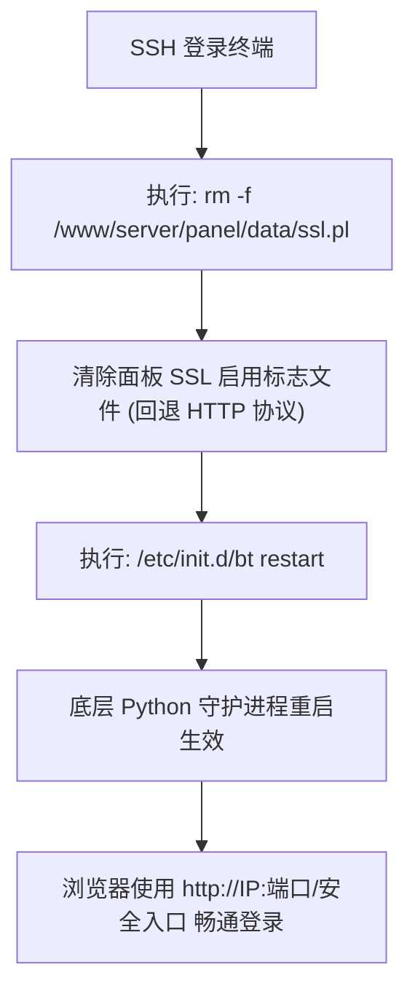

# aaPanel 宝塔国际版极简安装与运维实战指南

对于需要可视化管理 Linux 服务器、部署建站环境（LNMP / LAMP）、配置反向代理与自动化 SSL 证书的开发者来说，宝塔面板（BT Panel）一直是非常高效的工具。然而在国内版宝塔中，强制绑定手机号与实名要求、频繁的商业营销弹窗让许多追求轻量、纯粹运维环境的开发者感到困扰。

**aaPanel** 是宝塔官方面向海外与全球开发者推出的国际版本。本文将介绍 aaPanel 的核心特性，提供官方纯净免费版的一键安装部署流程，并深入剖析 IP SSL 访问异常及面板锁死时的关键**救砖指令**。

---

## 一、为什么选择 aaPanel（宝塔国际版）？

相比国内版宝塔面板，aaPanel 具备以下几个显著优势：

1. **无需绑定手机号**：安装完成后只需设置管理员用户名与密码即可登录，彻底告别国内手机号强制实名绑定的限制；
2. **纯粹轻量无弹窗**：界面风格极其清爽，去除了一切营销推广、商业广告与活动弹窗，回归纯粹的服务器管理工具本质；
3. **原生完整生态**：完全继承了宝塔优秀的软件商店生态，一键安装多版本 Nginx、Apache、OpenLiteSpeed、MySQL、MariaDB、多版本 PHP 并行、Redis、Node.js 管理器、Python 项目管理器以及 Docker 容器套件；
4. **全球多发行版兼容**：原生支持 Ubuntu（官方优先推荐 22.04 LTS）、Debian、AlmaLinux、Rocky Linux 以及 CentOS 等主流 Linux 纯净系统。

> [!NOTE] 系统环境建议
> 推荐在**全新纯净（Clean OS）**的 Linux 系统上安装 aaPanel。如果服务器上已自行通过 apt/yum 安装了 Apache、Nginx 或 MySQL，安装过程可能会产生端口冲突或配置文件覆盖。

---

## 二、官方纯净免费版一键安装流程

访问 aaPanel 官方下载中心（`https://www.aapanel.com/new/download.html`）时，官方页面提供了多种安装选项，包括针对 AI 智能体集成的 `aaPanel Free + OpenClaw` 捆绑版以及 `aaPanel Pro` 付费试用版。

为了保证系统的纯粹、极简与长期零费用稳定运行，我们**坚决剔除任何第三方捆绑与商业版试用脚本**，只采用官方标准的最纯净 **aaPanel Free 独立版**安装命令。

### 1. 纯净版官方安装脚本 (支持 IP SSL)

连接服务器 SSH 终端，以 `root` 超级用户权限执行以下一键安装命令：

```bash
URL=https://www.aapanel.com/script/install_panel_en.sh && if [ -f /usr/bin/curl ];then curl -ksSO $URL ;else wget --no-check-certificate -O install_panel_en.sh $URL;fi;bash install_panel_en.sh ipssl
```

### 2. 脚本执行逻辑深度剖析

上述单行组合命令设计非常严密，其核心逻辑拆解如下：

- **下载工具自适应**：脚本首先判断系统是否存在 `/usr/bin/curl`。若存在则通过 `curl -ksSO` 忽略不信任 SSL 并直接静默下载；若不存在则自动降级使用 `wget --no-check-certificate` 拉取，保证在不同 Linux 基础镜像中 100% 成功下载；
- **参数 `ipssl` 的作用**：在执行 `bash install_panel_en.sh ipssl` 时，安装器会自动基于服务器当前的公网 IP 生成自签名 SSL 证书，并直接以 HTTPS 安全通道启动后台管理面板，从源头防止管理账密在公网明文传输。

### 3. 安装交互与信息保存

在执行过程中，安装程序会提示确认安装目录（默认路径为 `/www`）：

```text
Do you want to install aaPanel to the /www directory now?(y/n): y
```

输入 `y` 并回车，脚本将自动完成 Python 依赖、运行环境与核心面板组件的编译装配（通常耗时 2~5 分钟）。

安装完成后，终端将输出如下关键登录凭证：

```text
==================================================================
aaPanel Internet Address: https://198.51.100.23:7800/8a7b6c5d
aaPanel Internal Address: https://10.0.0.5:7800/8a7b6c5d
username: aapanel_user
password: your_random_password
==================================================================
```

> [!IMPORTANT] 凭证保存与安全组放行
> 1. 请立即将终端输出的 **外网访问地址（包含唯一的安全入口后缀）**、**用户名** 与 **随机密码** 保存到本地密码管理器；
> 2. 如果您的云服务器托管在阿里云、腾讯云、AWS 或 Oracle Cloud 等平台，必须前往云控制台的 **安全组 / 防火墙策略** 中，添加入站规则放行该面板通信端口（如上例中的 `7800`，或系统随机分配的高位端口）。

---

## 三、核心避坑：自签 IP SSL 访问异常与终端救砖秘籍

启用 `ipssl` 参数安装后，许多用户在初次使用浏览器访问 `https://你的服务器IP:端口/安全入口` 时，常会遇到以下两种典型问题：

### 1. 现象一：浏览器拦截“您的连接不是私密连接”

- **报错提示**：Chrome / Edge 提示 `NET::ERR_CERT_AUTHORITY_INVALID`，Firefox 提示“潜在的安全风险”。
- **原因**：因为面板使用的是基于 IP 地址生成的自签名证书，而非由公共受信任根证书颁发机构（CA）签发的域名证书。
- **快速通过方式**：
  - 在 Chrome / Edge 警告页面点击「高级 (Advanced)」->「继续前往 IP (不安全)」；
  - 若 Chrome 页面没有继续前往按钮，可以直接在该页面空白处使用键盘盲打输入 `thisisunsafe`，浏览器即可自动解除拦截并放行。

### 2. 现象二：面板 SSL 损坏、握手失败或完全无法访问（终极救砖）

在某些现代浏览器（如开启了强制 HSTS）或自签名证书链损坏、端口协议识别错乱时，浏览器可能会直接报错 `SSL_ERROR_RX_RECORD_TOO_LONG` 或 `ERR_SSL_PROTOCOL_ERROR`，导致面板后台彻底死锁、完全进不去。

遇到此类紧急情况，无需慌张，更无需重装系统。登录服务器 SSH 终端，直接执行以下一行**救砖命令**：

```bash
rm -f /www/server/panel/data/ssl.pl && /etc/init.d/bt restart
```

### 3. 救砖命令原理解析



- **`/www/server/panel/data/ssl.pl`**：这是 aaPanel / 宝塔面板标记“当前是否开启面板 SSL”的底层控制标志文件。只要该文件存在，面板后台就会强制监听 HTTPS 协议；
- **`rm -f` 强制删除**：删除该文件后，面板配置自动降级为标准的纯 HTTP 协议；
- **`/etc/init.d/bt restart`**：平滑重启面板管理服务，使配置即时重载；
- **恢复访问**：此时在浏览器地址栏中将开头的 `https://` 改为 `http://`，访问 `http://服务器IP:端口/安全入口`，即可 100% 恢复正常登录！

> [!TIP] 推荐的最佳安全实践
> 恢复登录后，建议在「Settings（面板设置）」中为面板绑定一个独立的二级域名（例如 `panel.yourdomain.com`），并通过面板内置的 Let's Encrypt 一键申请正规免费的权威 SSL 证书。这样既保证了全链路 HTTPS 高强度加密，又彻底杜绝了 IP 自签名证书的浏览器告警与握手异常。

---

## 四、aaPanel 终端运维利器：bt 命令行菜单

aaPanel 继承了宝塔强大的底层管理脚本。日常维护中如果忘记了管理员密码、想要修改默认端口或清理登录限制，只需在服务器终端中直接输入：

```bash
bt
```

系统将呼出全功能交互式运维菜单：

```text
==================================================
               aaPanel CLI Tool
==================================================
(1) Restart aaPanel             (2) Stop aaPanel
(3) Start aaPanel               (4) Reload aaPanel
(5) Change panel password       (6) Change panel username
(7) Force-change MySQL password (8) Change panel port
(9) Clear panel cache           (10) Clear login restrictions
(11) Cancel IP binding          (12) Cancel domain binding
(13) Cancel basic auth          (14) View panel default info
(15) Clear panel logs           (16) Repair aaPanel
==================================================
```

### 最常用的快捷命令整理

除了进入交互菜单输入对应序号，也可以直接执行子命令快速操作：

| 运维场景 | 快速执行指令 | 说明 |
| :--- | :--- | :--- |
| **重启面板** | `/etc/init.d/bt restart` | 快速重载面板 Python 核心进程 |
| **查看登录信息** | `bt 14` | 终端回显完整的面板外网地址、安全入口与当前用户名 |
| **修改管理员密码** | `bt 5` | 根据终端提示直接输入新密码 |
| **修改管理员账号** | `bt 6` | 根据终端提示直接输入新用户名 |
| **修改面板端口** | `bt 8` | 自定义端口，建议修改为 10000~65535 之间的非知名端口 |
| **清除登录限制** | `bt 10` | 因密码多次输错被临时封禁 IP 时，执行此命令秒级解封 |
| **取消域名绑定** | `bt 12` | 域名解析错误无法访问时，快速解绑域名恢复 IP 访问 |

---

## 五、总结与安全防护建议

aaPanel（宝塔国际版）在保留宝塔图形化强大易用性的同时，彻底摆脱了手机号绑定与繁杂弹窗的束缚，是海外 VPS、出海业务以及个人独立开发者的首选服务器管理平台。

在生产环境中部署 aaPanel，建议牢记以下安全准则：
- 部署时使用官方纯净脚本，避免安装不必要的 Pro 版试用或复杂捆绑组件；
- 遭遇自签名 SSL 握手异常或面板锁死时，使用 `rm -f /www/server/panel/data/ssl.pl && /etc/init.d/bt restart` 快速降级回退；
- 生产环境建议修改面板默认端口（`bt 8`），并绑定域名配置正规 Let's Encrypt 证书；
- 合理配置云平台安全组，仅对外开放必要的 80、443 及面板管理端口，配合面板自带的「Security」防火墙模块实现最高等级的服务器防护。
